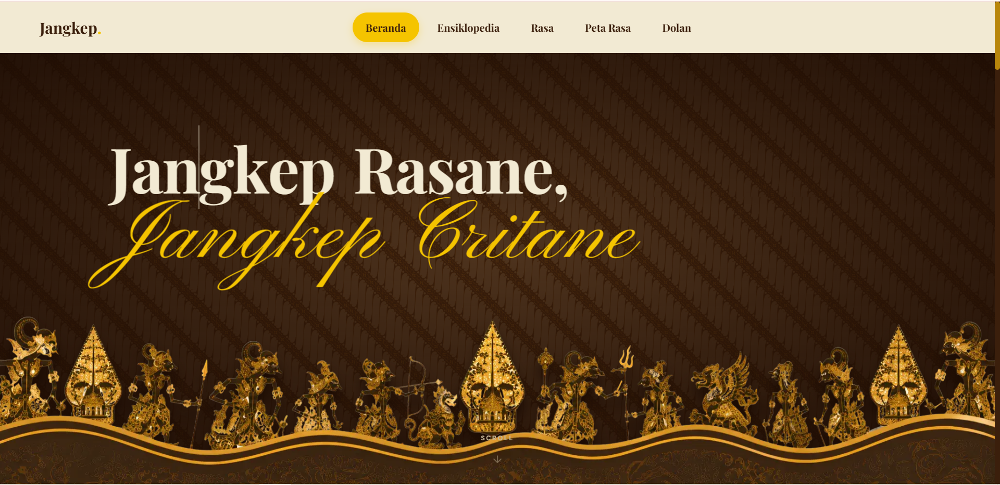
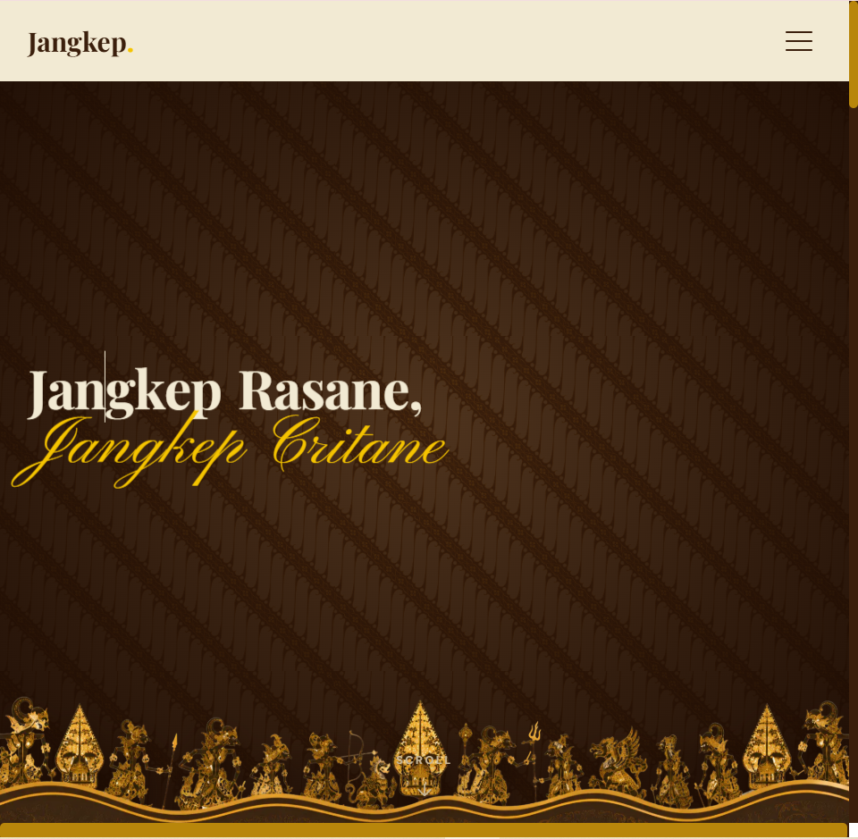
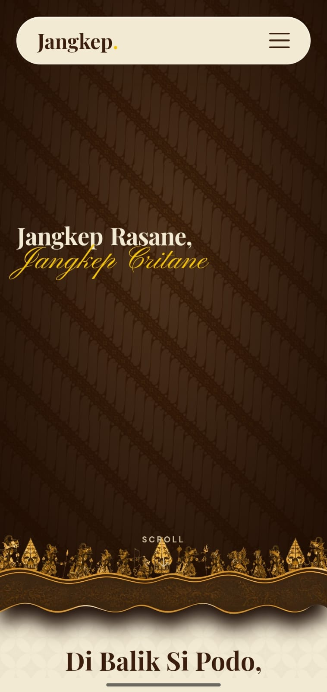
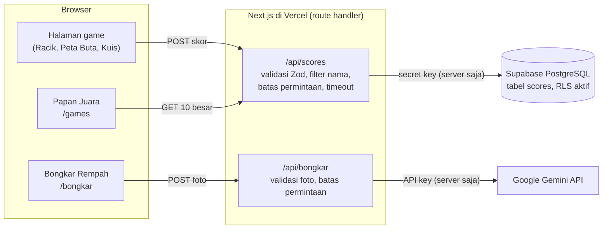

<div align="center">
  
  
  # Jangkep: Jangkep Rasane, Jangkep Critane
  
  *Website eksplorasi kuliner Jawa Tengah yang imersif, interaktif, dan edukatif.*

  **[Kunjungi Website Jangkep Live!](https://jangkep.vercel.app)**
</div>

---

## Tim Pengembang
Proyek ini dikembangkan oleh kelompok mahasiswa kelas **3SI1**:

| Nama Lengkap | NIM | Kelas |
| :--- | :--- | :--- |
| **M Rezky Raya Kilwouw** | 222313190 | 3SI1 |
| **Rifqi Muhadzib Ahdan** | 222313350 | 3SI1 |
| **Safira Inayah** | 222313365 | 3SI1 |

---

## Alasan Memilih Jawa Tengah
Jawa Tengah memiliki kekayaan kuliner peninggalan leluhur yang luar biasa, mulai dari keberagaman rasa (manis, gurih, pedas), filosofi mendalam di balik cara memasaknya, hingga akulturasi budaya. Sayangnya, dokumentasi kekayaan ini seringkali disajikan dengan kaku. Melalui **Jangkep**, kami ingin mengangkat derajat kuliner tradisional Jawa Tengah dengan balutan teknologi web modern (seperti efek paralaks, *scroll-telling*, dan gamifikasi), sehingga warisan kuliner Nusantara ini dapat dinikmati dan dipelajari oleh generasi muda dengan cara yang menyenangkan.

---

## Cara Instalasi Web

Ikuti langkah-langkah di bawah ini untuk menjalankan proyek Jangkep di komputer lokal Anda:

1. **Clone Repositori**
   ```bash
   git clone https://github.com/RifqiMuhA/jangkep.git
   cd jangkep
   ```

2. **Instalasi Dependensi**
   Pastikan Anda sudah menginstal [Node.js](https://nodejs.org/). Kemudian jalankan perintah berikut di terminal:
   ```bash
   npm install
   ```

3. **Jalankan Server Development**
   ```bash
   npm run dev
   ```

4. **Buka di Browser**
   Buka web browser Anda dan kunjungi `http://localhost:3000` untuk melihat dan berinteraksi dengan aplikasi.

---

## Cuplikan Layar (Screenshots)

Berikut adalah contoh tampilan antarmuka website **Jangkep** di berbagai ukuran layar:

### Tampilan Desktop


### Tampilan Tablet


### Tampilan Handphone (Mobile)


---

## Fitur Bongkar Rempah (AI)

Halaman `/bongkar`: pengguna mengunggah foto masakan, AI (Gemini) menebak hidangannya dan rempah utamanya,
lalu rempah itu dicocokkan dengan data rempah Jangkep (`src/data/rempah.ts`) dan ditampilkan di atas tampah.

1. Salin `.env.example` menjadi `.env.local`, lalu isi `GEMINI_API_KEY` (dari Google AI Studio).
2. Jalankan `npm run dev` dan buka `http://localhost:3000/bongkar`.

Kode fitur ini ada di `src/lib/bongkar/`, `src/app/api/bongkar/route.ts`, `src/app/bongkar/`, dan
`src/components/bongkar/`. Nama lain rempah (misalnya "turmeric" atau "laos") diatur di
`src/lib/bongkar/aliases.ts`.

**Evaluasi:** jalankan server, lalu `npm run eval` (21 foto uji di `eval/images/`, atribusi di
`eval/images/ATRIBUSI.md`). Hasil disimpan ke `eval/results.json`.

Hasil AI bersifat perkiraan dan edukatif. Di free tier Gemini, kuota sekitar 20 permintaan per hari per model
per project, dan waktu respons 5-20 detik.

## Fitur Papan Juara (Leaderboard)

Skor ketiga permainan di halaman Dolan disimpan bersama di **Supabase** (PostgreSQL). Tanpa login: pemain
mengisi **nama panggilan** di layar hasil permainan, lalu 10 skor tertinggi tiap permainan tampil di
**Papan Juara** (`/games#papan-juara`). Satu nama panggilan hanya menampilkan satu skor terbaiknya.

### Arsitektur



Browser tidak pernah berbicara langsung dengan Supabase maupun Gemini. Semua kunci hanya ada di server.

### Menyiapkan Supabase

1. Buat project di [supabase.com](https://supabase.com) (paket gratis cukup).
2. Buka **SQL Editor > New query**, tempel isi `supabase/schema.sql`, lalu **Run**. File ini membuat tabel
   `scores` (RLS aktif tanpa policy, jadi tidak bisa diakses dari luar server) dan fungsi `top_scores`.
3. Salin nilai berikut ke `.env.local` (lihat `.env.example`) **dan** ke Vercel
   (**Settings > Environment Variables**, centang Production dan Preview), lalu deploy ulang:
   - `SUPABASE_URL`: Project URL (tombol **Connect** di dasbor).
   - `SUPABASE_SECRET_KEY`: secret key berawalan `sb_secret_` (**Settings > API Keys**). Jangan pakai publishable
     key, dan jangan beri awalan `NEXT_PUBLIC_`.
4. Opsional: `npm run leaderboard:seed` mengisi 6 skor contoh per permainan (berlabel "contoh").
   Hapus sebelum penjurian dengan `npm run leaderboard:clear-samples` (hanya menghapus data contoh).

### Aturan skor

| Permainan | Rumus | Maks |
|---|---|---|
| Racik Masakan Jawa | 10 per bahan benar + 50 per masakan selesai + sisa detik kalau 5 masakan selesai | 700 |
| Dari Kota Mana? | 100 per masakan ditemukan + 5 x sisa detik kalau keempatnya ditemukan | 800 |
| Kenali Masakanmu | 100 per jawaban benar + sisa detik saat menjawab benar | 1150 |

Rumus ada di `src/lib/leaderboard/scoring.ts`, batasnya di `src/lib/leaderboard/games.ts`.

### Keamanan dan batasan yang diketahui

- Validasi di server: nama permainan harus dikenal, skor bilangan bulat dalam batas permainan, nama panggilan
  2-20 karakter (huruf, angka, spasi, `. _ - '`) dan lolos filter kata tidak pantas. Daftar kata ada di
  `src/lib/leaderboard/blocked-words.ts` dan mudah diedit.
- **Skor dihitung di browser**, jadi pemain yang paham teknis tetap bisa mengirim skor palsu selama masih dalam
  batas permainan. Untuk lomba ini dianggap cukup; pencegahan penuh butuh logika game di server.
- **Batas permintaan** (6 kiriman per menit per IP) disimpan di memori. Di Vercel tiap instance punya hitungan
  sendiri, jadi ini hanya perlindungan seadanya. Tidak ada layanan tambahan seperti Redis.
- Nama panggilan tidak unik: siapa pun bisa memakai nama yang sama, dan skornya digabung di Papan Juara.
- Panggilan ke Supabase dibatasi 6 detik. Kalau database tidak bisa dihubungi, halaman tetap berfungsi dan
  menampilkan pesan ramah serta tombol coba lagi.
- `@supabase/supabase-js` memberi peringatan bahwa Node.js 20 akan berhenti didukung. Pakai Node.js 22 atau lebih
  baru (Vercel: **Settings > General > Node.js Version**).
- Project Supabase gratis bisa **dijeda** kalau lama tidak dipakai. Buka dasbornya beberapa hari sebelum penjurian.

### Checklist uji manual

- [ ] Selesaikan tiap permainan, isi nama valid (misal `Si Podo`), lalu kirim: muncul peringkat dan tautan Papan Juara.
- [ ] Nama terlalu pendek (`A`), terlalu panjang (21+ karakter), berisi simbol (`<script>`), atau kata kasar
      (termasuk samaran seperti `4nj1ng`): ditolak dengan pesan ramah, game tetap normal.
- [ ] Skor di luar batas atau permainan tidak dikenal, misalnya lewat
      `curl -X POST localhost:3000/api/scores -H "Content-Type: application/json" -d '{"game":"x","nickname":"Budi","score":10}'`: status 400.
- [ ] Kirim lebih dari 6 skor dalam satu menit: ditolak dengan status 429 dan pesan tunggu.
- [ ] Ubah `SUPABASE_URL` di `.env.local` menjadi alamat salah, restart server: Papan Juara menampilkan
      "lagi ngaso" dengan tombol Coba lagi, form skor menampilkan pesan gagal dan tombol Kirim lagi, tidak ada layar error.
- [ ] Papan Juara kosong untuk satu permainan: muncul ajakan bermain.
- [ ] Tampilan di HP (lebar ~390 px): tab bisa digeser, baris tidak terpotong, form skor muat di kartu hasil.
- [ ] Nama terakhir dan rekor pribadi teringat di perangkat yang sama (localStorage).

### Sebelum penjurian

- [ ] Project Supabase aktif (tidak dijeda).
- [ ] Variabel lingkungan Supabase dan Gemini ada di Vercel, lalu website di-deploy ulang.
- [ ] Papan Juara diuji di link deploy, dari HP dan laptop.
- [ ] Data uji dibersihkan; data contoh (kalau dipakai) berlabel "contoh".
- [ ] Tidak ada kunci rahasia di repo atau di arsip yang dikumpulkan (`.env.local` tidak ikut).
- [ ] Video demo menunjukkan skor masuk Papan Juara, plus rekaman cadangan kalau database bermasalah.
- [ ] Diagram arsitektur di proposal dan slide sesuai dengan diagram di atas.

## Teknologi yang Digunakan
- **Framework Utama**: [Next.js](https://nextjs.org/) (React) dengan TypeScript
- **Styling**: Vanilla CSS & CSS Modules (Desain Kustom dengan tema khas Jawa/Batik)
- **Animasi & Interaksi**: 
  - [Framer Motion](https://www.framer.com/motion/) (Animasi layout dan gesture)
  - [GSAP](https://gsap.com/) (Animasi ScrollTrigger kompleks)
  - Lenis / Locomotive (Smooth Scrolling)
- **Fitur Spesial**: 
  - `react-pageflip` (Untuk interaksi buku resep manuskrip kuno 3D)
  - `@hello-pangea/dnd` (Untuk *Drag-and-Drop* mini-game racik bumbu)

## Fitur Unggulan
- **Ensiklopedia Kuliner**: Katalog kuliner interaktif yang dilengkapi filter visual kategori dan rasa.
- **Buku Resep Manuskrip**: Pengalaman imersif membalik halaman buku resep secara realistis dari kiri ke kanan.
- **Sejarah (*Scroll-Telling*)**: Cerita sejarah makanan yang dikemas dalam bentuk animasi horizontal dengan latar belakang wayang.
- **Game Meracik Masakan (*Dolan*)**: Mini-game interaktif (*drag-and-drop*) meracik bumbu ke dalam wajan yang dilengkapi animasi pantulan dan taburan bumbu.
